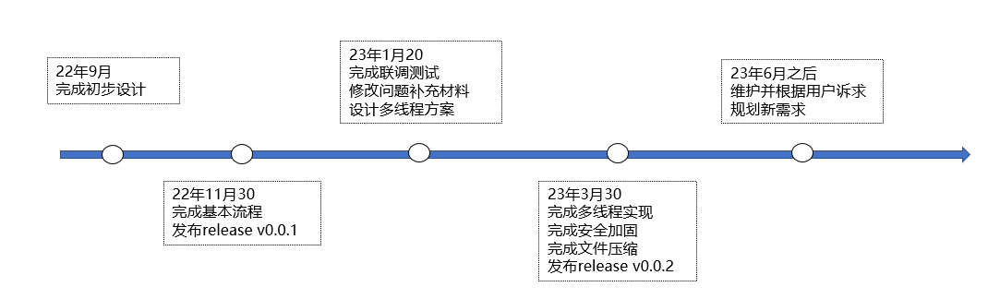

<div align="center">
<h1>Log4CJ2</h1>
</div>

<p align="center">


</p>

#### 介绍

仓颉语言实现日志打印功能，类似 log4j 三方件。

代码参考: https://github.com/gohutool/log4go

#### 路线



#### 软件架构

参见[Log4CJ 设计文档](./doc/Log4CJ%20Design.md)

源码目录

```shell
├── doc
├── src
│   ├── appender
│   │   ├── console_logger_appender.cj
│   │   ├── file_logger_appender.cj
│   │   ├── logger_appender.cj
│   │   ├── logger_appender_factory.cj
│   │   └──logger_appender_reference.cj
│   ├── config
│   │   ├── appender_config.cj
│   │   ├── appender_property.cj
│   │   ├── appender_ref.cj
│   │   ├── logger_config.cj
│   │   ├── logger_configuration.cj
│   │   └── root_logger_config.cj
│   ├── logger
│   │   ├── logger.cj
│   │   └── logger_manager.cj
│   └── utils
│       ├── log_level.cj
│       ├── log_record.cj
│       ├── pattern_converter.cj
│       ├── time_slice.cj
│       └── util.cj
├── resources
│   ├── log4cj.xml
├── test
│   ├── LLT
│   ├── UT
│   ├── HLT
```

- `doc` 库的设计文档、提案、库的使用文档、LLT 覆盖率报告
- `src` 库源码目录
- `resources` 资源文件目录
- `test` 测试用例目录

#### 接口说明
参见[主要类和函数说明](./doc/api.md)

#### 使用编译

参见[项目编译文件引用](./doc/quote_compiled_files.md)

#### 如何运行测试用例

参见[测试用例运行说明](./doc/LLT_running.md)

#### 使用说明

1. 打印日志
   
   代码示例：

```go
main(): Int64 {
    // 创建一个 Logger
    let logger = Logger_Manager.getLogger("com.hello")

    // 打印日志
    logger.info("hello")
    logger.info("hello")
    logger.error("hello")

    // 创建另一个 Logger
    let logger1 = Logger_Manager.getLogger("com.test1")
    logger1.warn("test1 waring")
    return 0
}
```

   打印结果：

```textile
[2022/10/22 23:38:08 CST 460] [INFO][com.hello] () hello
[2022/10/22 23:38:08 CST 460] [INFO][com.hello] () hello
[2022/10/22 23:38:08 CST 460] [ERROR][com.hello] () hello
[2022/10/22 23:38:08 CST 460] [WARN][com.test1] () test1 waring
```

   ()中为待实现的打印日志的具体文件执行代码行（仓颉暂未开放该api接口）

#### 待办事务

1. 代码健壮性处理

2. 多线程处理(目前采用spawn..getResult..方式)

3. 日志打包后压缩文件（目前采用zip4cj已完成一版）

4. 安全加固（文件权限，命令注入等）

5. 代码打包

6. UT补充(目前LLT89.4%)

#### 参与贡献

[@zhangxyjlu](https://gitee.com/zhangxyjlu)

[@helongfei](https://gitee.com/helongfei_it)
